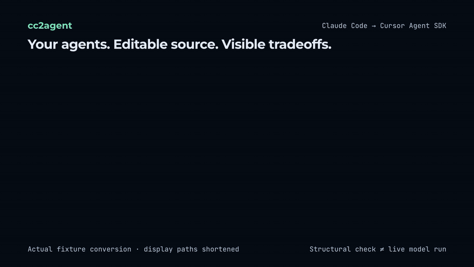

# cc2agent

Turn loose Claude Code subagents and Agent Skills into editable Cursor Agent SDK source, eval scaffolds, and a migration report that accounts for every frontmatter field.

[中文说明](README.zh-CN.md) · MIT · Node **22.13+** · targets **@grok/agent-sdk 0.3.0**



```bash
# From this checkout; cc2agent has not been published to npm yet.
npm install
npm run build
node dist/cli.js convert .claude/agents ~/.claude/skills/full-send \
  --with-deps --out ./my-agent
```

```text
.claude/agents/reviewer.md      → bot/subagents/reviewer/{agent.ts,instructions.md}
skills/full-send/SKILL.md       → bot/skills/full-send/SKILL.md
skills/*/scripts/*             → bot/tools/*.ts (disabled JSON adapter stubs)
frontmatter + unsupported APIs → MIGRATION.zh-CN.md + TODO(cc2agent) comments
skills + subagents             → evals/*.eval.ts
```

The converter never executes input scripts and refuses to overwrite output. Model names inherit by default; use an explicit map only after checking your account's model availability. A generated project that validates is a structural migration, not proof of model behavior or preserved permissions.

## Local installation and use

```bash
npm pack
npm install --global ./cc2agent-0.1.0.tgz
cc2agent inspect ./fixtures/tstack
cc2agent convert ./fixtures/tstack/skills --with-deps --out /tmp/my-tstack-agent
cc2agent demo full-send --out /tmp/full-send-agent
cc2agent demo pr-review --out /tmp/pr-review-agent
cc2agent doctor --dir /tmp/my-tstack-agent
```

After an actual npm publication, the intended command is `npx cc2agent convert <input> --out <directory>`. The command above is not a claim that an npm release exists.

Install the SDK using its documented package name:

```bash
npm install --global @grok/agent-sdk@0.3.0
cd /tmp/my-tstack-agent
npm install
agent-sdk validate --dir .
agent-sdk eval --dir . --list
# Interactive account authentication and paid model execution are separate steps:
agent-sdk login
agent-sdk dev --dir .
```

[Official SDK documentation](https://cursor.com/docs/agent-sdk) specifies `@grok/agent-sdk` (formerly `@cursor/bdk`). Do not substitute the announcement's `@cursor/agent-sdk` package name. See [verification notes](docs/upstream-verification.md) for the timestamped evidence and remaining checks.

## CLI

```text
cc2agent convert <input...> [--out <dir>] [--name <name>]
  [--model-map sonnet=<id>,opus=<id>] [--keep-model]
  [--root-tools read,grep,glob,ls,task] [--lang zh|en]
  [--with-deps] [--dry-run] [--json] [--no-validate]
cc2agent inspect <input...>
cc2agent demo <full-send|pr-review> [--out <dir>]
cc2agent doctor [--dir <project>]
```

Inputs can be individual subagent Markdown files, `.claude/agents/` trees, skill directories, a directory of skills, or a tstack repository. `--with-deps` includes the pinned tstack dependency graph. `--dry-run` previews without creating output; `--json` produces machine-readable output. Chinese is the default output language.

Subagent `model: inherit` is omitted. Other source model IDs are omitted with a warning unless mapped or explicitly kept. Unknown skill frontmatter remains in SKILL.md and is listed in the report. Every input field receives a mapped, degraded or dropped result. Tool names in prompts are scanned and explained, not silently rewritten.

`--root-tools` is an explicit root harness allowlist; omitting it preserves SDK defaults and may give agents broad tools. It cannot faithfully preserve different per-subagent permission policies. SDK task subagents retain their own harness toolset: a root allowlist is not proof of child isolation. `shell` is arbitrary execution, not read-only access. Review the report before using migrated prompts with real credentials.

## How this differs from official support

| Path | What it gives you |
| --- | --- |
| SDK `cursorPlugin()` | Runtime loading of Cursor/Claude plugins with manifests; useful when runtime mounting is enough |
| Copy SKILL.md | Native SDK skills; no converter needed for compatible skill files |
| cc2agent | Loose files, editable source, field-by-field loss accounting, foreign-tool warnings, eval scaffolds and Chinese demos |

The SDK's `init --from automation:` and `migrate` serve other migration paths. cc2agent uses public generated APIs and invokes the CLI for validation; it does not import SDK internal APIs. It does not implement unsupported hooks, MCP configuration, persistent Claude memory, or model-provider routing for you.

## The two demos

Both are adapted from a pinned [tstack](https://github.com/t3dotgg/tstack) MIT snapshot and include `LICENSE-tstack` and provenance. They are runnable project templates with explicit remaining runtime gates, not verified hosted services.

- **full-send:** five skills, a reviewer, Chinese PR preparation, a bounded read-only `pr_wait` server tool, and a gated `merge_pr`. The root has no shell; its authored workflow cannot run tests, git push or create a PR automatically. This is not a verified guarantee about the separate harness toolset used by child agents. It prepares local edits and a PR draft, then stops. The original Python watcher is retained with a disabled agent adapter. The authored merge tool requires `CC2AGENT_ALLOW_MERGE=1`, human tool approval, a configured GitHub-session repository, the exact current head SHA and a clean PR. It declares `effect: "write"` and a non-merging `dryRunResult`; eval sessions cannot merge.
- **pr-review:** council and comment-format skills, three reviewer perspectives, a Chinese `Council review` table, and an explicit same-model fallback statement. Its root excludes shell/edit/delete and its authored tools do not post reviews, comments or modify PR descriptions. Root settings do not prove child-agent isolation.

Unconfigured demos disable their GitHub channel, so local runs do not request credentials for `OWNER/REPO`. Set `bot/lib/settings.ts` to the intended `owner/repo` to enable non-draft `opened`, `reopened` and `ready_for_review` events. Both channels explicitly disable reply posting, reactions and mention handling. PR review requests read-only GitHub permission and seeds a bounded, revision-checked diff snapshot before the model turn. This works with sandbox enabled; `pr_wait` access from a sandboxed model remains unverified.

[Full-send operation guide](demos/full-send/README.md) · [PR-review operation guide](demos/pr-review/README.md)

## Evidence and release status

The acceptance repository is private; npm and public launch are on hold at the owner's request. The root package has `private: true`.

The checked-in tests exercise migration contracts, no-overwrite behavior, source safety, provenance and merge gate denial. Structural SDK checks validate generated fixtures and list eval cases. Official SDK login has also succeeded, and two authenticated model evals have passed:

- Generated `migration-smoke`: **1 case, 2 assertions passed** (`succeeded` and `loadedSkill`).
- PR-review council against an inline PR example: **1 case, 9 assertions passed** (completion, three completed reviewer delegations, `Council review`, the downgrade marker and three table rows). The reviewers inherit the same model; this does not establish three-provider execution or child-agent isolation.

Full-send's direct `agent-sdk run` passed a skill-loading check; the final default demo made one successful skill read, with no write/exec or merge call. A signed local replay of [private test PR #1](https://github.com/mreasonyang/cc2agent/pull/1) completed three reviewer delegations and a Chinese scoring table, with no tool errors, comments, reactions or reviews. The test PR was closed without merging. Replay is not a real hosted webhook delivery. Hosted `deploy --dry-run` reports no default team; no actual deployment ran and no deployment URL exists. npm publication, public release and social launch remain on hold.

See [acceptance results](docs/acceptance.md) for exact evidence. `eval --list` only proves discovery; the live eval results above cover their named assertions. Recognized tstack sources must include the verified MIT license. One conversion is limited to 128 MiB of generated content.

```bash
npm run check
node scripts/build-demos.mjs   # regenerate demo source from the pinned snapshot
```

SDK source/docs are not vendored. Its proprietary terms are separate from this project's MIT license. See [third-party notices](THIRD_PARTY_NOTICES.md). Based on tstack, with no affiliation or endorsement from Theo / T3.
