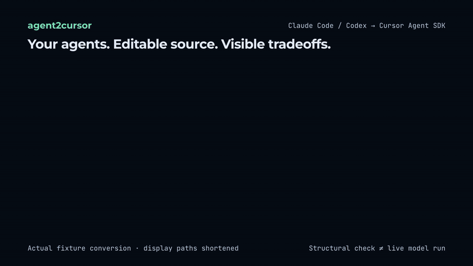

# agent2cursor

Convert existing Claude Code and Codex subagents and Agent Skills into editable [Cursor Agent SDK](https://cursor.com/docs/agent-sdk) (`@grok/agent-sdk`) TypeScript projects, with routing eval scaffolds and a field-by-field migration report.

[中文说明](README.zh-CN.md) · **0.1.0** · [MIT License](LICENSE) · Node **>=22.13** · Targets **`@grok/agent-sdk@0.3.0`**



If you already wrote subagents in `.claude/agents/*.md` or `.codex/agents/*.toml`, or skill folders containing `SKILL.md` (including [t3dotgg/tstack](https://github.com/t3dotgg/tstack) workflows), `agent2cursor` turns those loose files into a standalone Cursor Agent SDK project. It generates editable source files, a per-field migration report, and initial routing evals—it does **not** migrate underlying models or chat history, and it does **not** guarantee preserved runtime behavior or subagent permission boundaries.

```text
.claude/agents/code-reviewer.md → bot/subagents/code-reviewer/{agent.ts,instructions.md}
.codex/agents/reviewer.toml     → bot/subagents/<name>/{agent.ts,instructions.md}
skills/<name>/SKILL.md          → bot/skills/<name>/SKILL.md
skills/*/scripts/*              → bot/tools/*.ts (disabled JSON adapter stubs)
source fields + routing checks  → MIGRATION.zh-CN.md (or .en.md) + evals/*.eval.ts
```

## Install and use

Requires **Node.js >=22.13** and npm. The npm package is **`@kyun.si/agent2cursor`**; its command is **`agent2cursor`**. Version **0.1.0** is [published on npm](https://www.npmjs.com/package/@kyun.si/agent2cursor), with [verified publication and installation results](https://github.com/mreasonyang/agent2cursor/blob/main/npm-publication.json).

Run the input commands from the project containing your agents or skills. Choose either global installation or one-off `npx` usage below; both create the same SDK project.

### Global installation

```bash
npm install --global @kyun.si/agent2cursor@0.1.0
agent2cursor --help
agent2cursor inspect .claude/agents --lang en
agent2cursor convert .claude/agents --out ./my-agent --lang en
```

### Without global installation

```bash
npx --yes @kyun.si/agent2cursor@0.1.0 inspect .claude/agents --lang en
npx --yes @kyun.si/agent2cursor@0.1.0 convert .claude/agents --out ./my-agent --lang en
```

Pass only paths that exist. Claude Code skills can be supplied as `.claude/skills`, or as an individual directory containing `SKILL.md`. A standalone agent file, an agent directory, or a skill directory can be used alone; multiple inputs can be combined. See [Codex inputs](#convert-codex-assets) below. The default report language is Chinese; these English examples select `--lang en` explicitly. Source instructions are preserved rather than translated.

`inspect` writes nothing. `convert` creates a **new** output directory and refuses to overwrite an existing path. Review `my-agent/MIGRATION.en.md` and the generated `bot/` sources. Conversion does not install the target SDK or start a model. A fresh output normally reports `dependencies-missing` until its own dependencies are installed; this is not a successful SDK validation.

### Validate and run the generated project

From the directory where you created `my-agent`:

```bash
cd my-agent
npm install
npm run validate
npx agent-sdk eval --dir . --list
npx --yes @kyun.si/agent2cursor@0.1.0 doctor --dir .
```

These are structural checks and eval discovery; they do not run the model evals. The converter and generated SDK project have separate dependencies, so installing `agent2cursor` globally does not replace `npm install` inside `my-agent`.

After reviewing the migration report, permissions, model selection, and disabled script stubs, you can optionally run a real model from the **generated project directory**:

```bash
npx agent-sdk login
npm run dev -- --web
```

`npm run dev -- --web` starts the SDK development server and opens its playground. Send a request in the playground to invoke a model. Live execution requires a Cursor account with the appropriate model access. `--lang` selects generated instructions, reports, and eval prompts; it does not translate your original agents or skills.

- **SDK package name:** [Official Cursor Agent SDK docs](https://cursor.com/docs/agent-sdk) specify **`@grok/agent-sdk`** (formerly `@cursor/bdk`). Generated `package.json` pins it to `0.3.0` and declares `zod` `^3.25.0`; see [upstream verification](docs/upstream-verification.md).
- **Account requirements:** conversion and post-install structural checks (`inspect`, `convert`, `doctor`, `agent-sdk validate`, `agent-sdk eval --list`) need no Cursor login. `agent-sdk dev`, `agent-sdk run`, and actual model evals need login and model access. Optional `agent-sdk deploy` also needs hosting-enabled account/team and repository permissions.

`convert` and `demo` exit 0 after writing output when dependencies are missing; `validation.status` is `dependencies-missing`, so validation has not run. After installing the output's dependencies, `doctor` exits 0 only when validation passes. A real validation failure makes `convert` / `demo` exit 1 even though their output has already been written. The converter never installs dependencies automatically.

## Try the repository fixtures (optional)

The npm package includes the two demos but **does not include `fixtures/`, the converter's `src/` directory, or its development toolchain**. To run the repository examples, use a separate source checkout:

```bash
git clone https://github.com/mreasonyang/agent2cursor.git
cd agent2cursor
npm ci --ignore-scripts
npm run build

node dist/cli.js inspect ./fixtures/claude ./fixtures/tstack/skills/full-send --with-deps --lang en
node dist/cli.js convert ./fixtures/claude ./fixtures/tstack/skills/full-send \
  --with-deps --lang en --out ../agent2cursor-fixture
```

On this fixture input, the converter generates **28 files**: 4 subagents, 5 skills (including 4 `tstack` dependencies), and 1 disabled script-tool stub. The report is `../agent2cursor-fixture/MIGRATION.en.md`. The output directory must not already exist; choose a different `--out` path when repeating the example. Apply the validation steps above inside `agent2cursor-fixture` after reviewing its report. These samples demonstrate conversion and structural checks, not preserved runtime permissions or live-model behavior.

## Convert Codex assets

Using the installed command (or replacing `agent2cursor` with `npx --yes @kyun.si/agent2cursor@0.1.0`), pass project or personal agent directories, a standalone TOML file, and/or skill directories. The mixed-input example is an alternative; pass only paths that exist:

```bash
agent2cursor inspect .codex/agents .agents/skills --lang en
agent2cursor convert .codex/agents .agents/skills --out ./my-codex-agent --lang en
# Optional: combine Claude, Codex, and skills
agent2cursor convert .claude/agents .codex/agents .agents/skills --out ./mixed-agent --lang en
```

Use only paths that exist; either input can be used alone. Personal standalone agents under `~/.codex/agents` are also accepted. A project root discovers these agent trees and skill folders, while unrelated TOML files are ignored.

| Codex input | Conversion |
| --- | --- |
| Standalone `name`, `description`, `developer_instructions` | Required non-empty strings; generates subagent ID, delegation description, and the parsed instruction text. Invalid files fail explicitly. |
| `model` | Inherits the target parent by default. Use `--model-map source-id=target-id` or `--keep-model`; availability is not established by validation. |
| `model_reasoning_effort`, `model_reasoning_summary`, `model_verbosity` | Reported as dropped; model-ID mapping does not migrate these parameters. |
| `features.*`, `skills.*` | Reported as degraded; per-agent capability and skill restrictions are not enforced. Referenced skill paths are not read. |
| Parent settings, including sandbox, approval, provider, and MCP | Not imported. These do not override the parent in a standalone Codex agent either. Configure the target environment explicitly. |
| `agents/openai.yaml` | Copied unchanged. A valid `interface.default_prompt` becomes an eval trigger; every UI, policy, dependency, and unknown field receives a migration entry. Invocation policy is not enforced and MCP dependencies are not connected. |

This supports **standalone Codex TOML agents → Cursor Agent SDK**, not whole-session migration or output for Codex. Parent `config.toml`, `AGENTS.md`, credentials, and legacy `[agents.<name>] config_file` declarations are not imported. Inherited instructions, tools, and skills must be reviewed separately. Codex tool references receive suggestions without automatic prompt rewriting. See the [Codex fixtures](fixtures/codex) and [verified scope](docs/upstream-verification.md#codex-input-adapter-2026-10-28).

## When to Use agent2cursor

`@grok/agent-sdk` already supports native skills and plugins. Choose the lightest path that fits your assets:

| Approach | When to use it |
| --- | --- |
| Copy `SKILL.md` directly | You only have compatible `SKILL.md` directories and do not need subagent conversion, script stubs, or a migration report |
| SDK `cursorPlugin()` | You have a Cursor/Claude plugin manifest and runtime mounting is enough |
| `agent-sdk init --from automation:` / `migrate` | You are migrating a Cursor Automation or upgrading an older SDK project |
| **`agent2cursor`** | You hold loose Claude `.md` / Codex `.toml` agents, skill directories, or `tstack` workflows and want editable SDK source, field-by-field loss accounting, foreign-tool warnings, disabled script stubs, and routing eval scaffolds |

## What Gets Migrated (Example: `code-reviewer`)

Given [`fixtures/claude/agents/code-reviewer.md`](fixtures/claude/agents/code-reviewer.md):

```markdown
---
name: code-reviewer
description: Review changed code for defects, maintainability, and missing verification.
tools: Read, Grep, Glob
model: sonnet
---
Review the changed code. Prioritize concrete defects and cite the affected file and line.
Do not edit files. Explain what was verified and what remains uncertain.
```

`agent2cursor convert` emits `bot/subagents/code-reviewer/agent.ts`, writes the prompt body to `bot/subagents/code-reviewer/instructions.md`, and logs every frontmatter field in `MIGRATION.zh-CN.md` (or `MIGRATION.en.md`):

```ts
// bot/subagents/code-reviewer/agent.ts
// Generated by agent2cursor. Review the migration report before running.
import { defineAgent } from "@grok/agent-sdk";

export default defineAgent({
  description: "Review changed code for defects, maintainability, and missing verification.",
  // TODO(agent2cursor): tools: Security boundary lost: task children retain the harness task-tool toolset; do not assume root allowlists constrain them. Reference name mapping (read, grep, glob). For enforced read-only access use separate agents or disable task and constrain execution separately; shell can write.
  // TODO(agent2cursor): model: Omitted model to inherit the parent model; use --model-map to select a target model explicitly.
});
```

<details>
<summary><strong>Field-by-field disposition reference</strong></summary>

| Source asset or field | SDK output location | Disposition | Behavior |
| --- | --- | --- | --- |
| Subagent `name` | `bot/subagents/<id>/` | `✅ Mapped` / `⚠️ Degraded` | `✅` when already a valid slug; `⚠️` when normalized or derived from the filename |
| Subagent `description` | `bot/subagents/<id>/agent.ts` | `✅ Mapped` / `⚠️ Degraded` | `✅` when non-empty; `⚠️` with a generated placeholder when missing or blank |
| Subagent Markdown body | `bot/subagents/<id>/instructions.md` | `✅ Mapped` / `⚠️ Degraded` | Unchanged bodies are mapped; appending a shared-skill preload hint is explicitly reported as degraded, with the original text retained |
| Subagent `model` | `bot/subagents/<id>/agent.ts` | `✅ Mapped` / `⚠️ Degraded` | `inherit` is omitted (`✅`). Other IDs (`sonnet`, `opus`, `haiku`) are omitted by default (`⚠️`) to inherit the parent model unless mapped with `--model-map` (`✅`) or kept with `--keep-model` (`⚠️`) |
| Subagent `tools` / `disallowedTools` | `MIGRATION.*.md` + `TODO(agent2cursor)` | `⚠️ Degraded` | Per-subagent tool lists are unsupported in SDK `0.3.0`; `task` children retain the harness `task` toolset |
| Subagent `skills` | `bot/instructions.md` + `instructions.md` | `⚠️ Degraded` | Emits shared-skill loading hints (no native per-subagent preloading) |
| `permissionMode`, `hooks`, `mcpServers`, `memory`, unknown agent fields | `MIGRATION.*.md` + `TODO(agent2cursor)` | `❌ Dropped` | No verified 1:1 SDK equivalent; documented in the report for manual implementation |
| `SKILL.md` + supporting files | `bot/skills/<id>/**` | `✅ Mapped` / `⚠️ Degraded` | Keeps body, supporting files, and extra frontmatter (`license`, `metadata.*`); `name`/`description` degrade to `⚠️` if normalized/missing, and `allowed-tools` is marked `⚠️` |
| `skills/*/agents/openai.yaml` | Copied metadata + `evals/skills.eval.ts` | `✅ Mapped` / `⚠️ Degraded` | Valid `interface.default_prompt` becomes an eval trigger; UI, invocation policy, tool dependencies, and unknown fields are reported individually as metadata without SDK runtime semantics |
| `skills/*/scripts/*` | `bot/skills/<id>/scripts/*` + `bot/tools/<script>.ts` | `⚠️ Degraded` | Copies script without executable bits and emits a disabled `execution: "agent"` stub (`AGENT2CURSOR_STUB_DISABLED`) |

</details>

## CLI Reference

| Command or flag | Description |
| --- | --- |
| `convert <input...>` | Convert Claude `.md` / standalone Codex `.toml` files, `.claude/agents/` / `.codex/agents/` trees, skill directories, or a `tstack` repo into a new SDK project |
| `inspect <input...>` | Print the migration report (or `--json` summary) without writing files |
| `demo <full-send\|pr-review>` | Export one of the two adapted `tstack` demo projects (`--out <dir>`, `--json`, `--no-validate`) |
| `doctor [--dir <project>]` | Check Node `>=22.13` and run `agent-sdk validate` with credential-safe diagnostic summaries |
| `--out <dir>` | New output directory for `convert` (default `./my-agent`; never overwrites existing paths) |
| `--name <name>` | Generated agent name (`1–64` lowercase letters, digits, `-`, or `_`, starting with a letter or digit; default `converted-agent`) |
| `--lang <zh\|en>` | `convert` / `inspect` output language (default `zh`); selects generated instructions, eval prompts, and report filename. Does not translate source text or the built-in demos |
| `--with-deps` | Include sibling skills required by the `tstack` dependency graph |
| `--model-map <map>` | Map source models explicitly, e.g. `--model-map sonnet=<account-verified-id>` (verify ID availability on your account) |
| `--keep-model` | Keep unverified source model IDs as-is instead of omitting them to inherit |
| `--root-tools <list>` | Explicit root allowlist (`read,grep,glob,ls,shell,edit,task,delete`); omitting preserves SDK defaults |
| `--dry-run` / `--no-validate` / `--json` | Plan `convert` without writing files / skip `agent-sdk validate` / print machine-readable JSON |

## Included Demos

Both demos are adapted in Chinese from a pinned [t3dotgg/tstack](https://github.com/t3dotgg/tstack) MIT snapshot (`7de017b3fc9d50c03cf3ecb98fb71e0ca65a78bd`) and include `LICENSE-tstack` and `TSTACK-PROVENANCE.json`. They are included in the npm package and require no source checkout. Export either into a new directory:

```bash
agent2cursor demo full-send --out ./full-send-agent
agent2cursor demo pr-review --out ./pr-review-agent
```

Use the same `npx --yes @kyun.si/agent2cursor@0.1.0` prefix if you chose the one-off route. The demos remain Chinese workflows; `demo` does not accept `--lang`. After export, run `npm install` and `npm run validate` inside the chosen demo directory.

- **`full-send` ([operation guide](demos/full-send/README.md)):** five skills (`full-send`, `sol-loop`, `file-pr`, `babysit-pr`, `leaving-pr-comments`), a `reviewer` subagent, a one-shot read-only `pr_wait` snapshot tool (no polling), a disabled `pr_wait_script` stub alongside the retained Python `pr-wait` script, and a gated `merge_pr` tool. Its root tools exclude `shell`, so **it prepares local edits and a PR draft and stops before publishing or merging**—automatic test execution, `git push`, and PR creation are not implemented. `merge_pr` is off by default and requires `AGENT2CURSOR_ALLOW_MERGE=1`, human approval, a matching configured GitHub session, an open/non-draft/clean PR, and the exact current head SHA (eval sessions cannot merge).
- **`pr-review` ([operation guide](demos/pr-review/README.md)):** `council` and `leaving-pr-comments` with three reviewer subagents (`reviewer-a`, `reviewer-b`, `reviewer-c`). All three inherit the same parent model, outputting a Chinese `Council review` table and an explicit notice that the review uses three perspectives on one model rather than three separate model providers. Its root tools are read/search/delegate only, and its authored tools never post comments or edit PR descriptions.

Both demos disable their GitHub channel until `bot/lib/settings.ts` replaces `"OWNER/REPO"`. Even after configuring a repository, automatic reply comments, reactions, and `@mention` triggers remain disabled. `pr-review` pre-fetches a bounded, revision-checked diff snapshot on the host side before the sandboxed model turn; direct `pr_wait` calls from inside a sandboxed model turn remain unverified.

## Limitations and Verification Status

The [independent evaluation](evaluation/README.md) covers the corrected converter and revised routing evals. Earlier demo model runs and the signed PR replay were recorded before the rename from `cc2agent`; their [original evidence](docs/evidence/online-2026-10-27.json) retains its source hashes. These are separate runs, with their respective scope preserved.

- **Tool-name scan coverage:** a fixed, case-sensitive identifier list detects `WebFetch`, `WebSearch`, `AskUserQuestion`, `request_user_input`, `delegate_task`, `orchestrator_capabilities`, `watch_pull_request`, `unwatch_pull_request`, and `Monitor` in bodies and supporting Markdown. Matches may include instructions prohibiting a call; absence of a match does not establish compatibility. Source prompts are not rewritten.
- **Root allowlists do not isolate subagents:** `--root-tools` restricts the root agent only. In `@grok/agent-sdk@0.3.0`, `task` subagents retain the harness `task` toolset. Never assume a root allowlist makes child agents read-only, and never treat `shell` as read-only (it can write files and run arbitrary commands).
- **Script tools are disabled stubs:** conversion never executes source scripts. Generated `bot/tools/*.ts` wrappers return `AGENT2CURSOR_STUB_DISABLED` until an operator audits the copied source in `bot/skills/<id>/scripts/*`, implements the JSON stdin/stdout contract, and enables `shell`.
- **Input/output guard coverage:** conversion refuses to overwrite existing output directories, rejects symlinks, caps output at 128 MiB, skips or rejects known credential paths (`.env`, `.npmrc`, private key files), and rejects sensitive YAML/TOML keys (`token`, `apiKey`, `secret`). Parser diagnostics never echo source values. It does not scan arbitrary prose or binary attachments for secrets.

**Verification summary (each evidence level is tracked separately):**

| Evidence level | Status | What is and is not proven |
| --- | --- | --- |
| npm release & installation | **PASS — 0.1.0** | Public registry bytes match the tested archive. Anonymous clean installation, pinned/default `npx`, mixed conversion, both demo exports, and doctor before/after installing project dependencies passed. [Publication receipt](https://github.com/mreasonyang/agent2cursor/blob/main/npm-publication.json) |
| Offline tests & SDK structure | **PASS — 74 tests** | Node 22.13 / 24 CI passed. Claude, Codex, tstack, full-send, and pr-review generated projects passed SDK structure checks, strict TypeScript and eval discovery with independent dependencies. `eval --list` proves discovery, not live execution. [CI](https://github.com/mreasonyang/agent2cursor/actions/workflows/check.yml) |
| Independent conversion and routing evaluation | **PASS** (bounded dataset) | 24/24 normal conversions and post-install validations; revised generated routing evals passed 41/41 across 30 projects. Three real tasks, each repeated three times, matched direct-copy/plugin baselines. [Counts and source hashes](docs/evidence/independent-evaluation.json) |
| Live model runs | **Historical PASS** (narrow cases) | Official `agent-sdk login` succeeded. `migration-smoke` passed (**1 case / 2 assertions**: `succeeded`, `loadedSkill`). `pr-review` council inline diff passed (**1 case / 9 assertions**, same model / 3 perspectives). `full-send` local `run` loaded the skill with 1 read call and 0 writes/execs/merges |
| GitHub PR replay | **Historical PASS** (local replay) | [Historical test PR #1](https://github.com/mreasonyang/agent2cursor/pull/1) passed via HMAC-signed **local replay** (bounded snapshot + 3 reviewer delegates + Chinese table; 0 tool errors, 0 writes/execs, 0 GitHub comments/reactions/reviews; PR closed unmerged). Not a live hosted webhook delivery |
| Cloud hosting | **Not run / On hold** | The last recorded `agent-sdk deploy --dry-run` stopped because the test account had no default team configured. Hosted deployment has not been completed; no verified deployment URL is available |

The historical model and PR replay runs were not rerun for the Codex adapter, npm publication, or this documentation audit. These checks do not prove average model quality, multi-provider routing, or child-agent tool isolation. Full records: [acceptance results](docs/acceptance.md) · [upstream verification](docs/upstream-verification.md) · [sanitized online evidence](docs/evidence/online-2026-10-27.json) · [official example provenance](docs/official-examples.provenance.json).

## Contributing and License

Maintainer commands (`npm run check`, `npm run test:sdk`, `node scripts/build-demos.mjs`) and safety invariants are in [CONTRIBUTING.md](CONTRIBUTING.md). The source workspace keeps `private: true` to npm; `pack:local` creates a separate public archive. GitHub is public. The README files embedded in the immutable npm `0.1.0` tarball are release snapshots; this GitHub checkout contains the latest documentation corrections.

`agent2cursor` is MIT-licensed (`Copyright (c) 2026 Eason Yang`, [LICENSE](LICENSE)). The pinned snapshot in [`fixtures/tstack`](fixtures/tstack) ([`PROVENANCE.json`](fixtures/tstack/PROVENANCE.json)) and the adapted demos derive from [t3dotgg/tstack](https://github.com/t3dotgg/tstack), `Copyright (c) 2026 Theo Browne`, under the MIT license ([`fixtures/tstack/LICENSE`](fixtures/tstack/LICENSE) and `LICENSE-tstack`); recognized `tstack` inputs must retain this MIT notice. `@grok/agent-sdk@0.3.0` is a proprietary dependency (no SDK source or docs are vendored here). Not affiliated with or endorsed by Theo Browne, T3, Anthropic, Cursor, Anysphere, or xAI. See [THIRD_PARTY_NOTICES.md](THIRD_PARTY_NOTICES.md).
