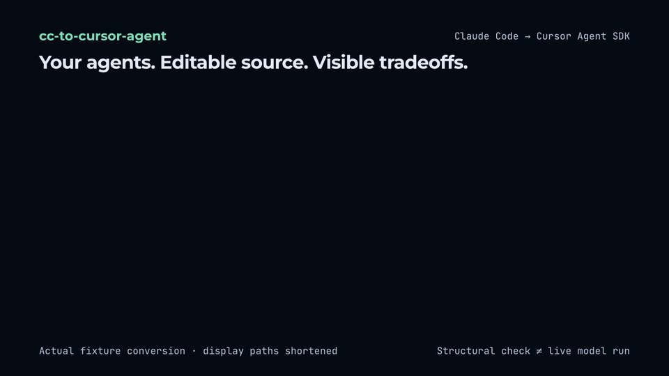

# cc-to-cursor-agent

把已写好的 Claude Code 子代理（subagents）与 Agent Skills 整理成可编辑的 [Cursor Agent SDK](https://cursor.com/docs/agent-sdk)（`@grok/agent-sdk`）TypeScript 项目，同时生成路由评测（eval）骨架和逐字段迁移报告。

[English](README.md) · **0.1.0** · [MIT 许可证](LICENSE) · Node **>=22.13** · 适配 **`@grok/agent-sdk@0.3.0`**



如果你手里已经有写好的 `.claude/agents/*.md` 子代理工作说明与 YAML 配置，或存放在目录中的 `SKILL.md` 技能文件（包括 [t3dotgg/tstack](https://github.com/t3dotgg/tstack) 这类工作流），`cc-to-cursor-agent` 可以把这些散装资产整理成独立的 Cursor Agent SDK 项目。它产出可编辑源码、逐个 frontmatter 字段的去向报告和初始路由 eval——**不会**迁移底层模型本身或聊天历史，也**不会**自动保证运行时行为或子代理权限边界与 Claude Code 等价。

```text
.claude/agents/code-reviewer.md → bot/subagents/code-reviewer/{agent.ts,instructions.md}
skills/<name>/SKILL.md          → bot/skills/<name>/SKILL.md
skills/*/scripts/*              → bot/tools/*.ts（默认禁用的 JSON 适配存根）
frontmatter + 路由检查           → MIGRATION.zh-CN.md（或 .en.md）+ evals/*.eval.ts
```

## 快速试用

`cc-to-cursor-agent`（`0.1.0`，[`package.json`](package.json) 保持 `"private": true`）尚未发布到 npm，请勿运行 `npx cc-to-cursor-agent`。直接在当前仓库编译，并用内置的 [`fixtures/`](fixtures/claude) 样本运行：

```bash
npm ci --ignore-scripts
npm run build

# 预览或转换仓库自带的 Claude 子代理 + tstack full-send 技能闭包（默认生成中文报告）
node dist/cli.js inspect ./fixtures/claude ./fixtures/tstack/skills/full-send --with-deps
node dist/cli.js convert ./fixtures/claude ./fixtures/tstack/skills/full-send \
  --with-deps --out /tmp/my-agent
```

```text
⚠️ 子代理限制未生效（4 个）：源 tools / disallowedTools / permissionMode 未迁移。SDK 校验通过不代表只读；--root-tools 只设置根代理白名单。
cc-to-cursor-agent v0.1.0 → @grok/agent-sdk 0.3.0
扫描: 4 agents, 5 skills, 1 script stubs
...
```

在这组内置样本输入下（4 个子代理、5 个 skill 含 4 个 `tstack` 依赖、1 个脚本存根），`cc-to-cursor-agent` 会生成 **28 个文件**，并在 `/tmp/my-agent/MIGRATION.zh-CN.md` 记录 **42 项迁移提醒**。具体文件数、提醒数与 `自检`（`Validation`）状态会随输入资产、参数及已安装依赖而变化（在 `/tmp/my-agent` 安装依赖前显示 `dependencies-missing` 属正常现象）。

保持当前仓库目录不变，直接为生成项目安装依赖并运行结构校验与 `doctor`：

```bash
(cd /tmp/my-agent && npm install && npx agent-sdk validate --dir . && npx agent-sdk eval --dir . --list)
node dist/cli.js doctor --dir /tmp/my-agent
```

若希望在本地全局直接使用 `cc-to-cursor-agent` 命令，可执行 `npm pack && npm install --global ./cc-to-cursor-agent-0.1.0.tgz`。

- **SDK 真实包名：** [Cursor Agent SDK 官方文档](https://cursor.com/docs/agent-sdk)指定的包名为 **`@grok/agent-sdk`**（旧称 `@cursor/bdk`），请勿使用早期公告中的 `@cursor/agent-sdk`；详见[上游核实说明](docs/upstream-verification.md)。生成的 `package.json` 将 `@grok/agent-sdk` 锁定为 `0.3.0`，并声明 `zod` 为 `^3.25.0`。
- **不同步骤的账号与权限要求：**
  1. **离线转换与结构校验**（`convert`、`inspect`、`doctor`、`agent-sdk validate`、`agent-sdk eval --list`）：无需登录 Cursor 账号或配置 API Key。
  2. **调用真实模型运行**（`agent-sdk dev`、`agent-sdk run`、实际执行 `agent-sdk eval`）：需先运行 `agent-sdk login` 登录，且账号具备对应模型访问权限。
  3. **云端托管部署**（`agent-sdk deploy`）：可选步骤，需账号所属团队已开通 hosting 权限并授权对应仓库。

`convert` / `demo` 在工程已写出、但缺少声明的 SDK 或 `zod` 依赖时退出 0，`validation.status` 为 `dependencies-missing`，并列出缺失包名；这时尚未执行校验。安装依赖后运行 `cc-to-cursor-agent doctor --dir <project>`，`doctor` 在校验通过前仍返回非零。真实校验错误仍使转换退出 1；转换器不会自动安装依赖。

## 适用场景与官方方案对比

`@grok/agent-sdk` 已原生支持直接加载 `SKILL.md` 和挂载插件，可按手头资产选择最简方案：

| 方案 | 适用情况 |
| --- | --- |
| 直接复制 `SKILL.md` | 只有现成兼容的 `SKILL.md` 目录，不需要转换子代理、脚本存根或生成逐字段迁移报告 |
| SDK `cursorPlugin()` | 已有带清单（manifest）的 Cursor / Claude 插件，只需运行时挂载 |
| `agent-sdk init --from automation:` / `migrate` | 从 Cursor Automation 迁移，或升级旧版 SDK 项目 |
| **`cc-to-cursor-agent`** | 手头有散装 `.claude/agents/*.md`、多技能目录或 `tstack` 工作流，希望导出为可编辑的 SDK 源码、获得逐字段损失清单、异构工具警告、禁用脚本存根与路由 eval 骨架 |

## 转换前后实例与字段去向（`code-reviewer`）

以仓库自带的 [`fixtures/claude/agents/code-reviewer.md`](fixtures/claude/agents/code-reviewer.md) 为例：

```markdown
---
name: code-reviewer
description: Review changed code for defects, maintainability, and missing verification.
tools: Read, Grep, Glob
model: sonnet
---
Review the changed code. Prioritize concrete defects and cite the affected file and line.
Do not edit files. Explain what was verified and what remains uncertain.
```

`cc-to-cursor-agent convert` 会生成 `bot/subagents/code-reviewer/agent.ts`，把提示词正文写入 `bot/subagents/code-reviewer/instructions.md`，并在 `MIGRATION.zh-CN.md`（或 `MIGRATION.en.md`）逐项记录每个 frontmatter 字段的结论：

```ts
// bot/subagents/code-reviewer/agent.ts
// Generated by cc-to-cursor-agent. Review the migration report before running.
import { defineAgent } from "@grok/agent-sdk";

export default defineAgent({
  description: "Review changed code for defects, maintainability, and missing verification.",
  // TODO(cc-to-cursor-agent): tools: 危险：子代理工具限制未生效，task 子代理保留 harness 自己的工具集；不能假定根白名单会约束子代理。工具名参考映射 (read, grep, glob)；若必须强制只读，需使用独立代理或禁用 task，并另行约束执行环境；shell 可写入。
  // TODO(cc-to-cursor-agent): model: 已省略 model，继承父代理模型；使用 --model-map 显式指定目标模型。
});
```

<details>
<summary><strong>逐类输入与 frontmatter 字段去向表</strong></summary>

| 源文件或字段 | SDK 输出位置 | 迁移结论 | 处理方式 |
| --- | --- | --- | --- |
| 子代理 `name` | `bot/subagents/<id>/` | `✅ 已映射` / `⚠️ 降级` | 已是合法目录 ID 时为 `✅`；发生字符规范化或缺失回退为文件名时为 `⚠️` |
| 子代理 `description` | `bot/subagents/<id>/agent.ts` | `✅ 已映射` / `⚠️ 降级` | 非空有效时为 `✅`；缺失或空白时生成占位描述并标为 `⚠️` |
| 子代理 Markdown 正文 | `bot/subagents/<id>/instructions.md` | `✅ 已映射` / `⚠️ 降级` | 正文未变化时标为已映射；追加共享技能预加载提示时明确标为降级，并说明保留原文、末尾追加提示 |
| 子代理 `model` | `bot/subagents/<id>/agent.ts` | `✅ 已映射` / `⚠️ 降级` | `inherit` 直接省略（`✅`）；`sonnet`、`opus`、`haiku` 等默认省略以继承父模型（`⚠️`），除非用 `--model-map` 显式映射（`✅`）或用 `--keep-model` 原样保留（`⚠️`） |
| 子代理 `tools` / `disallowedTools` | `MIGRATION.*.md` + `TODO(cc-to-cursor-agent)` | `⚠️ 降级` | SDK `0.3.0` 不支持子代理级工具限制，`task` 子代理仍使用 harness `task` 工具集 |
| 子代理 `skills` | `bot/instructions.md` + `instructions.md` | `⚠️ 降级` | 生成共享 skill 加载提示（无原生子代理独立预加载机制） |
| `permissionMode`、`hooks`、`mcpServers`、`memory` 及未知代理字段 | `MIGRATION.*.md` + `TODO(cc-to-cursor-agent)` | `❌ 丢弃` | 目标 SDK 无已核实的等价字段，在报告中列出供人工补齐 |
| `SKILL.md` 及附属文件 | `bot/skills/<id>/**` | `✅ 已映射` / `⚠️ 降级` | 保留正文、附属文件与额外 frontmatter（`license`、`metadata.*`）；`name`/`description` 被规范化或缺失时标为 `⚠️`，`allowed-tools` 标为 `⚠️` |
| `skills/*/agents/openai.yaml` | `evals/skills.eval.ts` | `✅ 已映射` / `⚠️ 降级` | 存在有效 `interface.default_prompt` 时用作 eval 触发词（`✅`），否则回退为默认触发词（`⚠️`） |
| `skills/*/scripts/*` | `bot/skills/<id>/scripts/*` + `bot/tools/<script>.ts` | `⚠️ 降级` | 复制脚本内容（去除可执行位），并在 `bot/tools/` 生成默认禁用的 `execution: "agent"` 存根（`CC_TO_CURSOR_AGENT_STUB_DISABLED`） |

</details>

## 命令行参考

| 命令或参数 | 说明 |
| --- | --- |
| `convert <input...>` | 将子代理 `.md`、`.claude/agents/` 目录、skill 目录或 `tstack` 仓库转换为新的 SDK 项目 |
| `inspect <input...>` | 仅输出迁移报告（或 `--json` 摘要），不写入任何文件 |
| `demo <full-send\|pr-review>` | 导出内置的两个 `tstack` 改编示例项目（支持 `--out <dir>`、`--json`、`--no-validate`） |
| `doctor [--dir <project>]` | 检查 Node `>=22.13` 并调用 `agent-sdk validate` 输出脱敏诊断摘要 |
| `--out <dir>` | `convert` 的新输出目录（默认 `./my-agent`；路径已存在时拒绝覆盖） |
| `--name <name>` | 生成的代理名称（`1–64` 位小写字母、数字、`-` 或 `_`，以字母或数字开头，默认 `converted-agent`） |
| `--lang <zh\|en>` | 生成的说明书、eval 提示词与 `MIGRATION.zh-CN.md` / `MIGRATION.en.md` 语言（默认 `zh`） |
| `--with-deps` | 按 `tstack` 依赖图自动补齐同级目录中被依赖的关联技能 |
| `--model-map <map>` | 显式映射模型 ID，如 `--model-map sonnet=<已核实模型ID>`（需用自己的账号核实可用性） |
| `--keep-model` | 原样保留未验证的源模型 ID，而不是省略以继承父模型 |
| `--root-tools <list>` | 显式设置根代理工具白名单（`read,grep,glob,ls,shell,edit,task,delete`）；不传则使用 SDK 默认值 |
| `--dry-run` / `--no-validate` / `--json` | 仅计算生成计划不写文件 / 跳过 `agent-sdk validate` / 输出机器可读 JSON |

## 内置示例（Demos）

两个示例均基于 [t3dotgg/tstack](https://github.com/t3dotgg/tstack) 固定 MIT 快照（`7de017b3fc9d50c03cf3ecb98fb71e0ca65a78bd`）改编为中文工作流，附带 `LICENSE-tstack` 与 `TSTACK-PROVENANCE.json`。可通过 `node dist/cli.js demo <full-send|pr-review> --out <dir>` 导出：

- **`full-send`（[操作说明](demos/full-send/README.md)）：** 含 5 个技能（`full-send`、`sol-loop`、`file-pr`、`babysit-pr`、`leaving-pr-comments`）、1 个 `reviewer` 子代理、做一次只读快照且不轮询的 `pr_wait` 工具、默认禁用的 `pr_wait_script` 存根（保留原版 Python `pr-wait` 供审阅），以及带门禁的 `merge_pr` 工具。根代理不含 `shell`，因此**默认只完成本地代码修改、评审并输出 PR 草稿，在发布和合并前停止**——未实现自动跑测试、`git push` 和创建 PR。`merge_pr` 默认关闭，必须同时满足 `CC_TO_CURSOR_AGENT_ALLOW_MERGE=1`、人工批准本次调用、匹配已配置 GitHub 仓库会话、PR 处于 open/非 draft/clean 状态且 `expectedHead` 精确匹配当前 head SHA（eval 会话禁止合并）。
- **`pr-review`（[操作说明](demos/pr-review/README.md)）：** 含 `council` 与 `leaving-pr-comments` 技能及 3 个评审子代理（`reviewer-a`、`reviewer-b`、`reviewer-c`）。三个子代理继承同一父模型，输出中文 `Council review` 评分表，并明确声明当前是同一模型的三种视角而非三家模型厂商。根代理仅保留只读搜索与委派工具，不提供发评论或改 PR 描述的工具。

两个示例在 `bot/lib/settings.ts` 保持默认 `"OWNER/REPO"` 时完全禁用 GitHub channel；配置实际仓库后也显式关闭自动回复评论、reaction 和 `@mention` 触发。`pr-review` 在服务端预先拉取并校验有界 diff 快照供沙箱内模型读取；而在沙箱模型回合中直接调用 `pr_wait` 仍未通过验收。

## 核心限制与验收状态

[独立评测](evaluation/README.md)覆盖修复后的转换器与新版路由 eval。较早的 demo 真实模型与 PR 签名回放结果来自更名之前（原名 `cc2agent`），[原始证据](docs/evidence/online-2026-10-27.json)保留对应源码哈希；不同轮次的结果与验证范围分别记录。

- **工具名扫描范围：** 固定名单区分大小写检测正文和附属 Markdown 中的 `WebFetch`、`WebSearch`、`AskUserQuestion`、`request_user_input`、`delegate_task`、`orchestrator_capabilities`、`watch_pull_request`、`unwatch_pull_request`、`Monitor`。命中可能来自禁止调用的说明；未命中不代表工具兼容，不改写源提示词。
- **根代理工具白名单不等于子代理隔离：** `--root-tools` 仅约束根代理。`@grok/agent-sdk@0.3.0` 的 `task` 子代理仍保有 harness 自身的 `task` 工具集，不能把根白名单当作子代理只读的证明；同时任何启用 `shell` 的配置都能写文件和执行任意命令，绝非只读。
- **脚本工具默认是禁用存根：** 转换过程绝不执行输入脚本。生成的 `bot/tools/*.ts` 固定返回 `CC_TO_CURSOR_AGENT_STUB_DISABLED`，需操作员审查 `.cursor/skills/<id>/scripts/*` 中的原脚本、实现 JSON stdin/stdout 契约并开启 `shell` 后才能启用。
- **输入与输出防护范围：** 转换器拒绝覆盖已有输出目录、拒绝符号链接、限制单次生成体积上限为 128 MiB，跳过或拒绝已知凭据路径（`.env`、`.npmrc`、私钥文件），并拒绝敏感 YAML frontmatter 键名（`token`、`apiKey`、`secret`）且不回显源值；它不会对任意正文段落或二进制附件做全量秘密扫描。

**当前验收状态摘要（各证据层级严格区分）：**

| 证据层级 | 状态 | 已验证范围与未覆盖边界 |
| --- | --- | --- |
| 离线单测与结构校验 | **PASS**（已有证据） | 仓库清理前 59 项本地测试通过。生成项目在独立临时目录中安装自身依赖，通过 SDK `validate` / `info` / `eval --list` 及严格 `tsc`。`eval --list` 仅证明发现用例；本次清理未重跑这些测试 |
| 独立转换与路由评测 | **PASS**（限定数据集） | 正常转换及安装后校验 24/24；新版自动路由 eval 在 30 个项目中 41/41 通过。3 个真实任务各重复 3 次，与直接复制/插件对照打平。[计数与源码哈希](docs/evidence/independent-evaluation.json) |
| 真实模型运行 | **PASS**（窄用例） | 已完成官方 `agent-sdk login`。`migration-smoke` 通过（**1 条用例 / 2 个断言**：`succeeded`、`loadedSkill`）；`pr-review` 内联 diff 评审通过（**1 条用例 / 9 个断言**，同模型 3 视角）；`full-send` 本地 `run` 完成 1 次 skill 读取，0 次写入/执行/合并 |
| GitHub PR 回放 | **PASS**（本地回放） | [私有测试 PR #1](https://github.com/mreasonyang/cc-to-cursor-agent/pull/1) 经 HMAC 签名**本地回放**通过（有界快照 + 3 次子代理委派 + 中文评分表；0 工具错误、0 写入/执行、0 GitHub 评论/reaction/review；测试 PR 已关闭且未合并）。不等于线上托管 webhook 投递 |
| 云端托管与 npm 发布 | **未运行 / 暂缓** | 测试账号未配置默认团队（`no default team`），`agent-sdk deploy --dry-run` 在前置条件处停止，未执行实际部署，无部署 URL。仓库保持私有，软件包设置 `private: true`，暂不发布 npm |

上述单点结果不证明任意输入下的平均模型质量、多厂商路由或子代理运行时隔离。完整记录见：[验收记录](docs/acceptance.md) · [上游核实说明](docs/upstream-verification.md) · [脱敏线上证据](docs/evidence/online-2026-10-27.json) · [官方示例来源记录](docs/official-examples.provenance.json)。

## 开发维护与许可证

维护者自检命令（`npm run check`、`npm run test:sdk`、`node scripts/build-demos.mjs`）与仓库安全守则见 [CONTRIBUTING.md](CONTRIBUTING.md)。

`cc-to-cursor-agent` 采用 [MIT 许可证](LICENSE)（`Copyright (c) 2026 Eason Yang`）。[`fixtures/tstack`](fixtures/tstack)（[`PROVENANCE.json`](fixtures/tstack/PROVENANCE.json)）中的固定快照与两个改编示例源自 [t3dotgg/tstack](https://github.com/t3dotgg/tstack)，`Copyright (c) 2026 Theo Browne`，采用 MIT 许可（保存在 [`fixtures/tstack/LICENSE`](fixtures/tstack/LICENSE) 与 `LICENSE-tstack` 中）；被识别的 `tstack` 输入源必须保留该 MIT 声明。`@grok/agent-sdk@0.3.0` 是专有依赖（本仓库不内置或再分发其源码与文档）。本项目与 Theo Browne、T3、Anthropic、Cursor、Anysphere 或 xAI 无官方关联或背书。详见 [THIRD_PARTY_NOTICES.md](THIRD_PARTY_NOTICES.md)。
